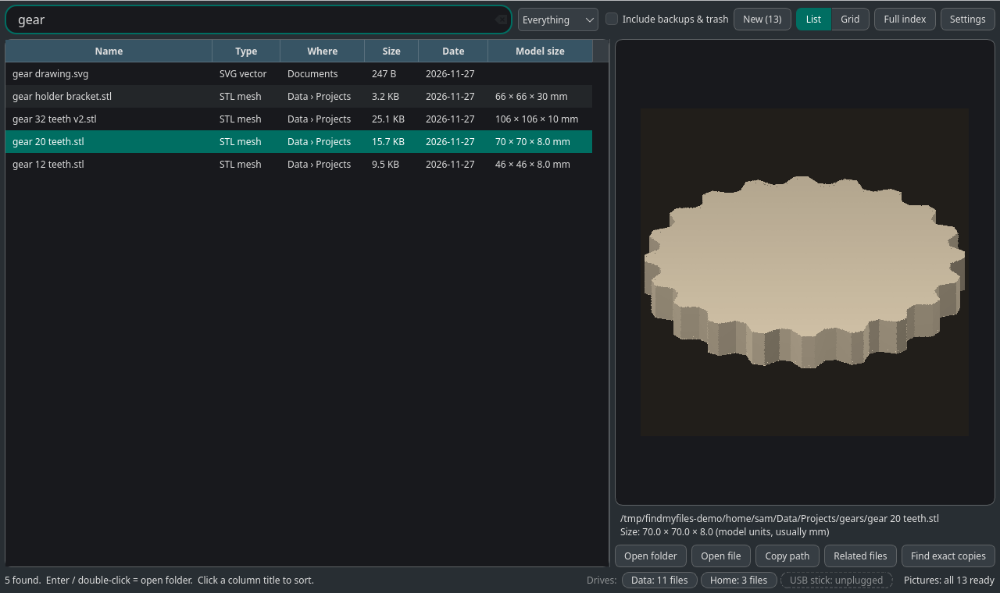
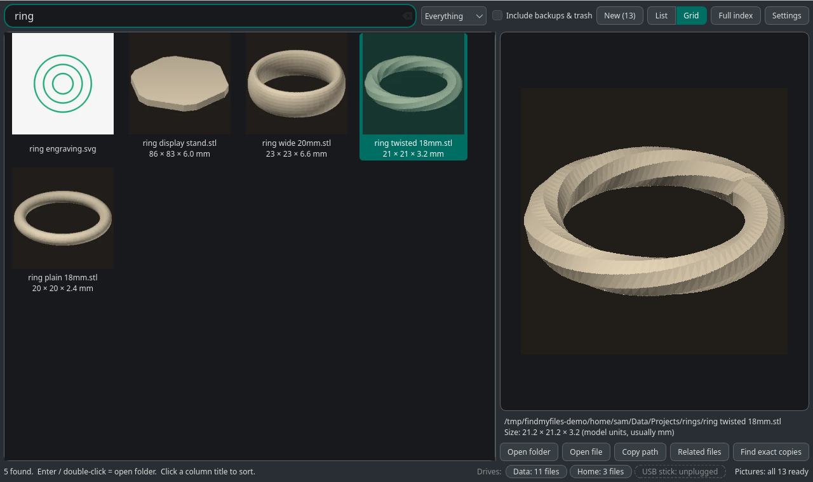
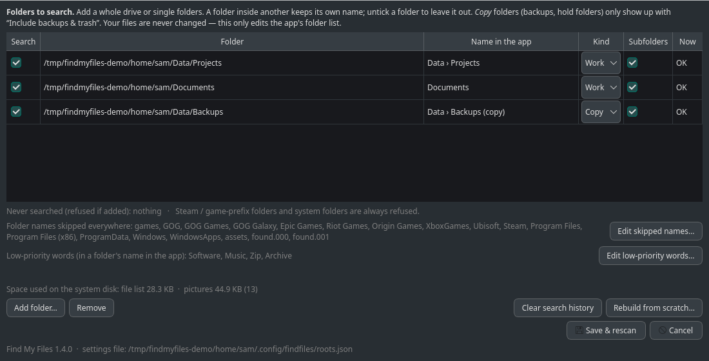

# Find My Files

**Find any 3D, print, laser or vector file on every drive in a second, and see it before you
open it.** Type a few words, get the file, a picture of the model and its size in mm.
Your desktop's own search usually looks only in the home folder; this looks on every drive you add.





Linux desktop app (Python 3 + PySide6). Built and used on Manjaro with KDE Plasma. It never
changes your files: it only reads them.

## What it does

- **Searches every drive at once**, in about 50 ms. Every word must match, in any order.
  Accents are optional, plurals are found too, and English and Romanian words find each other
  (`cross` finds `cruce`). The word list is in `search.py` and is easy to extend.
- **Shows a real preview.** STL, OBJ, 3MF and GLB are drawn from their real geometry. Slicer,
  CAD, vector, G-code and laser files show the picture saved inside them, or their toolpath.
  Videos show a real frame and can be played in the window.
- **Model size in mm** for every model. Type `60mm` to find models whose largest side is about
  60 mm, alone or with words.
- **List or Grid**: a table, or a wall of pictures.
- **Related files**: every version and part of the same project.
- **Find exact copies**: compares whole files, byte for byte.
- **Looks inside archives**: files in `.zip`, `.rar` and `.7z` are found and previewed.
- **New files show up by themselves** a few seconds after you save them. **New** lists what
  arrived in the last 7 days.
- **Drag a result** into a slicer, Blender or a file manager (it is copied, never moved).
- **Open with** your own programs per file type, from the right-click menu.

## Install

Tested on **Manjaro / Arch**. Other distributions should work but are not tested yet.

```
git clone https://github.com/grumpybollocks/find-my-files-linux.git ~/find-my-files
cd ~/find-my-files
sh install.sh
```

`install.sh` checks what is needed, tells you the exact command for anything missing, and adds
**Find My Files** to the app menu. It writes only inside your home folder and never asks for a
password. `sh install.sh --desktop` also puts an icon on the Desktop; `sh install.sh --check`
only checks.

What it needs:

| Needed | For | Manjaro / Arch package |
| --- | --- | --- |
| Python 3.10 or newer | the app | `python` |
| PySide6 with QtSvg, QtPdf, QtMultimedia | the window, previews, video player | `pyside6`, `qt6-multimedia` |
| numpy | drawing 3D models | `python-numpy` |
| ffmpeg, ffprobe | video pictures and details (optional) | `ffmpeg` |
| 7z | contents of `.7z` and `.rar` (optional) | `7zip` |

```
sudo pacman -S --needed pyside6 qt6-multimedia python-numpy ffmpeg 7zip xdg-utils
```

On Debian / Ubuntu, Fedora and openSUSE the script prints that distribution's package names.
Anywhere else: `python3 -m pip install --user -r requirements.txt`, plus ffmpeg and 7z.

To remove it: `sh uninstall.sh` (add `--data` to also delete the app's own file list, settings
and saved pictures).

## First run

1. Start **Find My Files**. It begins with the home folders that exist (Desktop, Documents,
   Downloads, Pictures, Videos, under whatever names your desktop's language gives them).
2. Open **Settings** and press **Add folder…** to add a drive or any folder. Add a whole drive
   and, if you like, some folders inside it under their own names.
3. Press **Save & rescan**. The first scan reads everything once; later starts only check
   which folders changed.

## The window

**Top bar**

| Control | What it does |
| --- | --- |
| Search box | type words; `60mm` searches by model size |
| Type box | All my work, 3D models, Print files, 2D / vector, Laser, 3D scans, Images, Archives, Everything |
| Include backups & trash | also show folders you marked as *Copy* in Settings |
| New | files that arrived in the last 7 days, newest first |
| List / Grid | table or pictures (**Ctrl+G**) |
| Full index | read every folder again and make missing pictures (**F5**). Uses the drives and some CPU, so it only runs when you press it |
| Settings | folders to search, skipped names, disk space used |

**Results**

- Click a row for the preview. Double-click or **Enter** opens its folder with the file selected.
- Click a column title to sort. Drag a title's edge to change the width, drag a title to move it.
- **Right-click the column titles** to hide or show columns (extra ones: Folder, Ext, Drive),
  sort by any column in either direction, return to best-match order, or reset.
- Right-click a result for Open with, Open folder, Copy path, Related files, Exact copies.

**Bottom bar**

| Item | Meaning |
| --- | --- |
| Status text (left) | how many results, or what the app is doing |
| Drive chips, e.g. `Data: 31,256 files` | one per drive: how many of its files can be found. **Click** to show only that drive (click again for all drives); **right-click** for Settings. A dashed chip is a drive that is unplugged: its files still show but cannot be opened |
| `Pictures: 9,709 / 9,771 ready` | saved preview pictures. Click it to make the missing ones in the background |
| `Scanning: …` | shown only while a scan runs |

**Keys:** **Ctrl+F** search box · **Esc** clear · **Enter** open folder · **Ctrl+Shift+C** copy
path · **Ctrl+G** list / grid · **F5** full index.

## Settings

- **Folders to search**: tick, add, remove. *Work* folders are searched normally; *Copy*
  folders (backups, hold folders) only show with **Include backups & trash**.
- **A folder inside another** keeps its own name. **Untick** a folder to leave it out, also
  when a ticked drive contains it.
- **Skipped folder names**: folders with these names are never read, wherever they are
  (games, program folders, assets). Steam libraries and system folders are always refused.
- **Low-priority words**: a folder whose name in the app contains one of these words
  (Software, Music, Zip, Archive by default) ranks last, is not watched live, and archives
  inside it are not opened.
- **Never searched**: drives listed under `"never"` in the settings file are refused and never
  read. Use it for a damaged drive or a Windows system drive.

The settings file is `~/.config/findfiles/roots.json`.



## Safe by design

- **Read-only.** Nothing is moved, renamed or deleted. Dragging a result copies it.
- **No made-up pictures.** A preview is shown only when the file really contains one, or real
  geometry to draw.
- **Light when idle.** No scanning unless a folder changed or you press Full index. Pictures
  are made one at a time at the lowest priority, and pause when memory is short.
- **Small on disk.** The file list and the saved pictures (WebP) live in your home folder;
  Settings shows how much space they use.

## Where it keeps its own data

| What | Where |
| --- | --- |
| Settings, programs per file type, window state | `~/.config/findfiles/` |
| File list | `~/.local/share/findfiles/` |
| Saved pictures | `~/.cache/findfiles/` |

## Known limits

- The quick check at start cannot see a file saved over itself, or files copied in by a tool
  that keeps the folder's old date. Press **Full index** if something is missing.
- "Open folder" selects the file in Dolphin and in file managers that support the desktop's
  standard call; elsewhere it opens the folder only.
- Only tested on Manjaro with KDE Plasma so far.

## For developers

See [docs/DEVELOPER.md](docs/DEVELOPER.md). Tests: `python3 -m unittest discover -s tests`
(they use temporary folders only and never touch real drives).
